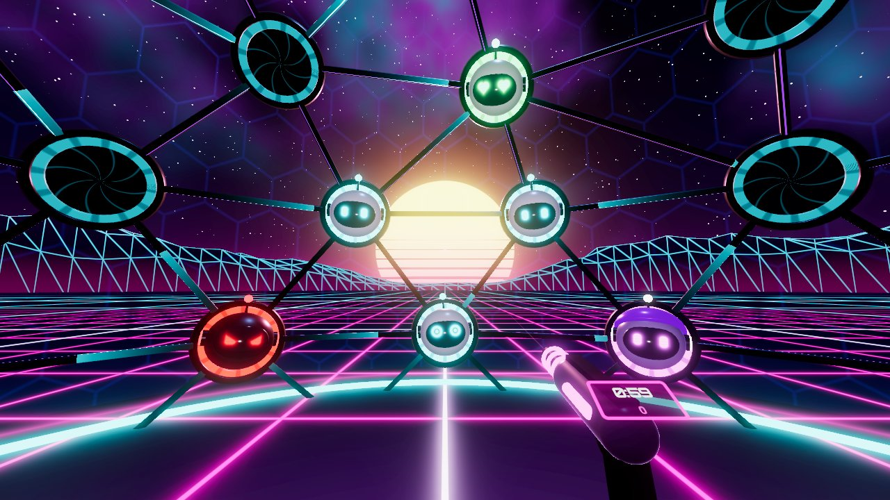
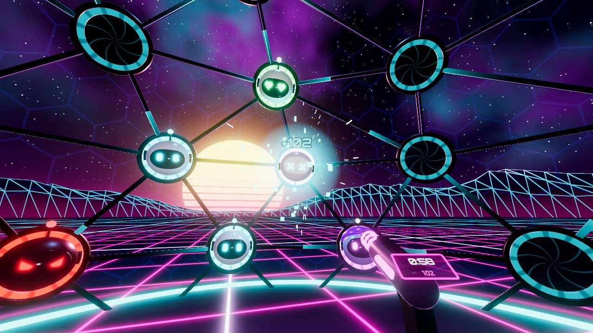
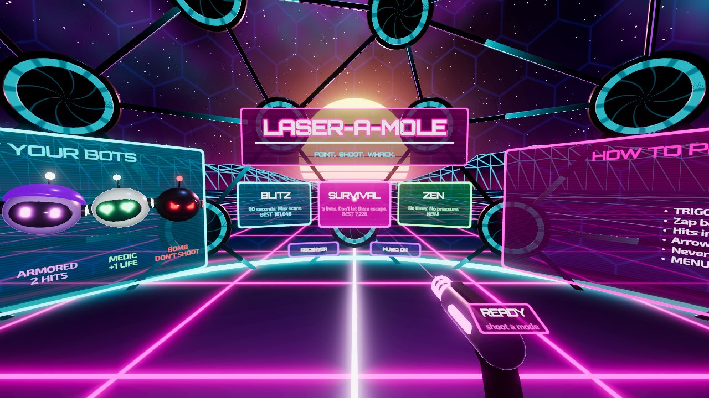
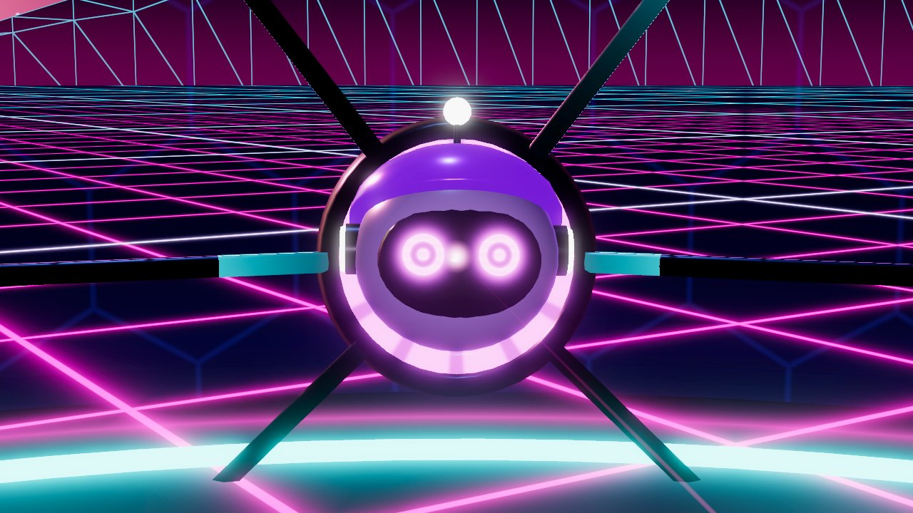

# Laser-a-Mole

A VR whack-a-mole game with frickin' lasers, built with **Godot 4.7.2** and OpenXR.

You stand on a glowing platform inside a geodesic dome of neon pipes, under a
synthwave sky. Cute screen-faced robots pop out of hatches all around you, in
front, overhead and behind. Point, pull the trigger, and zap them before they
duck back in.

| | |
| --- | --- |
|  |  |
|  |  |

*Screenshots are rendered by Godot 4.7.2 (Mobile renderer) in desktop mode.*

## Playing

| Action | VR (Quest, Index, Vive, WMR, Pico…) | Desktop fallback (no headset) |
| --- | --- | --- |
| Fire | Trigger (both hands hold a blaster) | Left click / Space |
| Aim | Point the controller | Mouse (click once to capture it) |
| Pause / resume | Menu button (left), or B / Y | Esc (also releases the mouse) |
| Menus | Shoot the buttons | Shoot the buttons |
| Recenter | Shoot **RECENTER**, or hold the Oculus/Meta button | — |

### Modes

* **Blitz**: 60 seconds, highest score wins. The dome starts with just the
  front section powered and expands to the sides and then all the way around
  you as the minute goes on.
* **Survival**: 5 lives. Every regular or armored bot that escapes costs a
  life, and so does shooting a bomb. Medic bots give one back. It keeps
  getting faster until you drop.
* **Zen**: no timer and no lives, at a relaxed pace with the whole dome
  active. Pause and choose *Quit run* to leave.

Results show your score, rank (S–E), how many bots you whacked out of how many
appeared, accuracy, and your best combo. Best scores are saved per mode.

### The bots

| Bot | Looks like | Notes |
| --- | --- | --- |
| Bot | White, cyan eyes | 100 pts |
| Golden | Shiny gold, star eyes | 500 pts, hides fast |
| Armored | Purple helmet | 2 hits (the first knocks the helmet off) |
| Medic | Mint, heart eyes | +1 life in Survival |
| Bomb | Black, angry red eyes, ticking | **Don't shoot.** Costs points, or a life in Survival |

### Scoring

* Every 5 hits in a row raises your multiplier (x2, x3 … up to x8).
* A miss or an escaped bot resets it.
* Hitting a bot within 0.8 s of it popping up adds a reaction bonus of up to +50 ("QUICK!").
* Pattern events spice things up: **RING RUSH** (a wave racing around a
  ring), **SURROUNDED!** (four at once, one in each direction) and **GOLD RUSH**.

### Finding bots

* **Arrows** at the edge of your view point at every bot you can't see.
  Bigger arrows mean the bot is further behind you, and faster pulsing means
  it is about to hide. Bombs never get an arrow.
* **Blips** on the floor ring around your feet give a 360° overview.
* Every pop, taunt and explosion is positional 3D audio, so you can hear
  where the bots are.
* Bots look scared when you aim at them, and their eyes follow your laser dot.

## Running it

1. Install **Godot 4.7.2** (the standard build, not .NET).
2. Open the project. On first open Godot imports the assets and writes some
   `.uid` / `.import` / `openxr_action_map.tres` files. Commit those.
3. **Quick test without a headset:** press **F5**. If no OpenXR runtime is
   available the game falls back to a mouse-look desktop mode.
4. **Quest 2 over Link:**
   * In the Meta Quest Link PC app go to *Settings → General* and set Meta Quest
     Link as the **active OpenXR runtime**.
   * Connect the Link cable and start Link in the headset.
   * Press **F5** in Godot. The game runs in the headset and mirrors to the
     game window.
5. **Other PC headsets** (Index, Vive, WMR, Pico Link) work through SteamVR or
   their own OpenXR runtime. Godot's default OpenXR action map already binds
   the trigger, menu and B/Y actions for all of the common controllers.

### Standalone Quest build (for later)

1. Set up Android export in Godot (*Editor → Manage Export Templates*, plus
   the Android SDK and JDK as described in Godot's
   [Exporting for Android](https://docs.godotengine.org/en/stable/tutorials/export/exporting_for_android.html) docs).
2. Install the **Godot OpenXR Vendors** plugin from the Asset Library and enable it.
3. Add an Android export preset with *XR Mode: OpenXR*, enable the Meta vendor
   plugin, use `arm64-v8a`, and deploy over USB.

The project uses the **Mobile** renderer so the same project runs on PC VR and
standalone. On Android it automatically turns off bloom, the force-field
shield and the explosion lights to keep the frame rate up.

## Tuning

| What | Where |
| --- | --- |
| Difficulty curve (spawn rate, bots out at once, how long they stay up, when the dome expands, bot mix, events) | `scripts/game/director.gd` |
| Mode rules (duration, lives, ramp time, rank thresholds) | `scripts/game/game_mode.gd` |
| Points, combo step, reaction bonus | `scripts/game/game_manager.gd` |
| Dome size and hatch layout (rows, counts, elevations) | `scripts/world/dome.gd` |
| Colors | `scripts/palette.gd` and the shader uniforms in `shaders/` |
| Lighting, fog, bloom, tonemapping | `scripts/world/world_builder.gd` |
| Sounds and music | `tools/generate_audio.py`, then run `python3 tools/generate_audio.py` (needs numpy, and ffmpeg for the music) |

## Automated tests

`tests/smoke_test.tscn` plays through the whole game without a headset. It
shoots the real menu buttons, plays Blitz, Survival and Zen with an
auto-aiming player, and checks pause/resume. It exits with code 1 if anything
fails or the engine logs an error:

```sh
godot --headless --path . --xr-mode off res://tests/smoke_test.tscn --fixed-fps 30
```

`tests/screenshots.tscn` renders a set of review screenshots (it needs a real
renderer, so don't use `--headless`):

```sh
godot --path . --xr-mode off res://tests/screenshots.tscn --fixed-fps 30 -- --shots=/absolute/output/dir
```

When you set up an export preset, add `tests/*` to *Resources → Filters to
exclude files* so the tests stay out of release builds.

## How it's built

Everything is generated in code and shaders, so there are no textures or 3D
models to manage. `scenes/main.tscn` is a single node that runs `scripts/main.gd`,
which assembles the game:

* `world/world_builder.gd`: sky (`sky.gdshader`), lights, neon grid floor,
  wireframe mountains and the hex platform.
* `world/dome.gd` + `hatch.gd`: hatch layout, pipes (one mesh with flowing
  energy pulses), the core, and the force-field shield. All 37 hatches are
  drawn with MultiMeshes, so the dome costs only a few draw calls.
* `actors/bot.gd` + `bot_model.gd`: bot behaviour (pop, taunt, retreat,
  die) and the model, whose screen face is an SDF shader (`bot_face.gdshader`)
  with 8 expressions.
* `player/player_rig.gd` + `blaster.gd`: OpenXR rig or desktop camera,
  blasters with aim laser, beams, recoil, haptics and a score screen on the gun.
* `game/`: `game_manager.gd` (state machine, scoring), `director.gd`
  (spawning and difficulty), `game_mode.gd`, and `targeting.gd` / `shootable.gd`
  (analytic ray hit tests, with no physics bodies needed).
* `ui/`: 3D menus (`menu.gd`, `button_3d.gd`), the arrow HUD, the floor radar,
  and the announcer.
* `fx/fx.gd`: pooled explosions, sparks and score popups.
* Autoloads: `Sfx` (pooled 3D audio and music) and `Save` (settings and best scores).

Adding a weapon means writing another `Blaster`-like node that calls
`Targeting.instance.cast()` and `target.on_shot()`.

## Credits

See [CREDITS.md](CREDITS.md).
